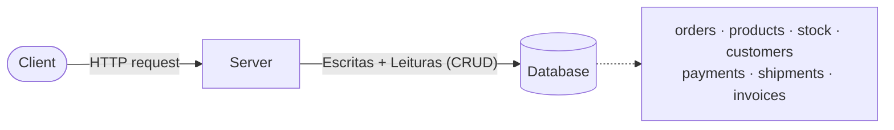
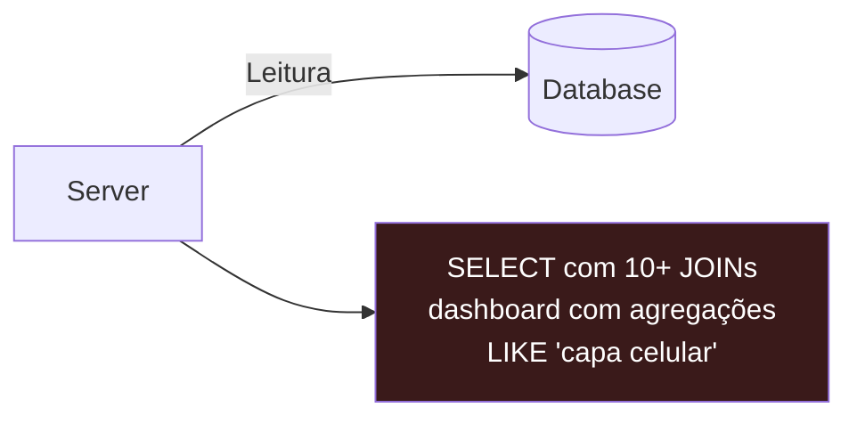
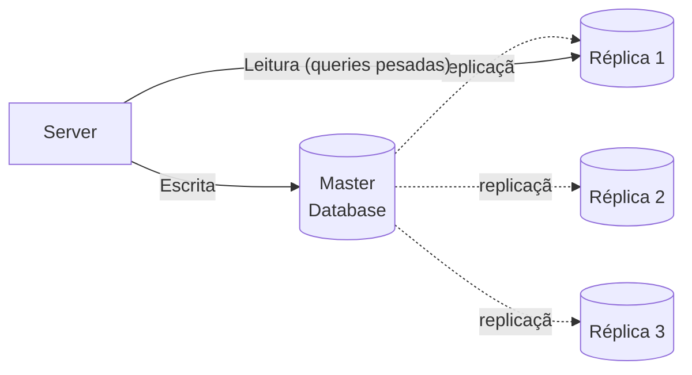
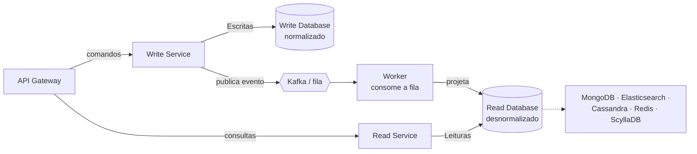
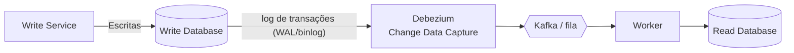

# CQRS para quem nunca viu — explicação leiga

> Referência: vídeo do Renato Augusto — *"CQRS: O PADRÃO ARQUITETURAL QUE TODO PROGRAMADOR PRECISA CONHECER!"*
> (transcrição completa em `transcricao.md`; os diagramas aqui são recriados em Mermaid)

## A analogia: a cozinha do restaurante

Imagine um restaurante. Existe **um caderno de pedidos** onde os garçons anotam
o que cada mesa pediu (escrita) e onde o caixa consulta o que cobrar (leitura).

Enquanto o restaurante é pequeno, um caderno só funciona. Agora imagine o
restaurante virando uma rede com centenas de mesas: os garçons ficam se
atropelando para anotar no mesmo caderno, e o gerente ainda fica parando todo
mundo para fazer perguntas gigantes tipo *"quanto vendemos de cada prato por
bairro nos últimos 90 dias?"* — uma pergunta que exige folhear o caderno
inteiro, cruzando páginas, enquanto ninguém consegue anotar pedido novo.

**CQRS é separar em dois cadernos:**

- **Caderno da cozinha (escrita)**: anotações rápidas, na ordem que chegam —
  "pedido 42: 1 pizza, 2 sucos". Otimizado para registrar.
- **Caderno do gerente (leitura)**: um resumo já mastigado — total por prato,
  faturamento por hora — montado por um ajudante que fica lendo o caderno da
  cozinha e copiando os totais. Otimizado para consultar.

O ajudante é o **worker**; o aviso de que chegou pedido novo é a **fila de
eventos** (Kafka/SNS+SQS). Entre o pedido ser anotado e o resumo ser atualizado
passa um tempinho — o resumo pode estar alguns segundos "atrasado". Isso tem
nome: **consistência eventual**.

## O problema que o vídeo mostra

Todo mundo aprende assim: front-end → back-end → **um banco só**. Esse banco
recebe `INSERT/UPDATE` (escrita) **e** `SELECT` (leitura) ao mesmo tempo.

O problema: as leituras de um e-commerce não são leves. Olha a lista do vídeo
— consultar produto exige `JOIN` em stock, sellers, reviews, shipping_rates,
categories, price, ads, orders, questions, taxes... e o dashboard do vendedor
é um agregado gigante ("faturamento por cidade, últimos 90 dias, agrupado por
semana"). Essas queries pesadas competem por CPU/lock com as escritas.

## Primeira tentativa (que NÃO é CQRS): read replicas

A saída óbvia: jogar as leituras para **réplicas de leitura** do banco.

Isso ajuda — escrita vai pro master, leitura pras réplicas. **Mas o vídeo
deixa claro: isso não é CQRS.** Por quê? Porque a réplica tem **exatamente o
mesmo schema normalizado**. A query monstruosa de 20 JOINs continua sendo uma
query monstruosa — só que agora rodando em outra máquina. Você aliviou a
contenção, não a complexidade da consulta.

## A ideia do CQRS: separar de verdade

**Command Query Responsibility Segregation** = "segregação da responsabilidade
de comando e consulta". Dois caminhos separados:

- **Lado do comando (write)**: recebe "cadastra produto", "muda preço",
  "baixa estoque". Escreve num banco normalizado (o "Write Database").
- **O evento**: depois de gravar, o write service avisa o mundo — publica numa
  fila/tópico (Kafka no vídeo, SNS+SQS na nossa demo).

- **O worker**: consome a fila e monta o **Read Database** — desnormalizado,
  no formato exato que a tela precisa (sem JOIN). Pode ser MongoDB,
  Elasticsearch, Redis, ScyllaDB... a tecnologia certa para *ler*, não para
  escrever.
- **Lado da consulta (read)**: só faz `SELECT` simples no modelo pronto.

Existe ainda a variante com **CDC/Debezium**: em vez do serviço publicar o
evento, uma ferramenta lê o *log de transações* do banco de escrita e gera os
eventos automaticamente.

## O preço: consistência eventual

Depois que você grava, a leitura leva um instante para refletir — o evento
precisa viajar pela fila e ser projetado. Se alguém cadastra um produto e
consulta no mesmo milissegundo, pode não aparecer. **Isso não é bug, é o
modelo.** O vídeo enfatiza: CQRS não é pra tudo. Sistema comum, leitura e
escrita equilibradas? Arquitetura tradicional resolve com menos peças.

## Resumo em uma frase

> **CQRS**: "quem escreve não atende telefone; quem lê o resumo não atrapalha
> a cozinha." Dois modelos (um otimizado p/ gravar, outro p/ consultar),
> sincronizados por eventos, com consistência eventual.

## E onde a nossa demo encaixa?

| No vídeo | Na demo (`docker compose up`) |
|---|---|
| API Gateway | *(omitido — chamamos o script direto)* |
| Write Service + Write DB (Postgres) | `write_service.py` + tabela `products-write` (DynamoDB) |
| Kafka / fila de mensageria | SNS `product-events` → SQS `product-events-queue` |
| Worker que consome a fila | `projection_worker.py` (container) |
| Read DB (Mongo/Elastic/Redis) | tabela `products-read` (DynamoDB desnormalizada) |
| Read Service | `read_service.py` |

Próximo passo: rodar a demo — `docs/03-roteiro-demo.md`.
