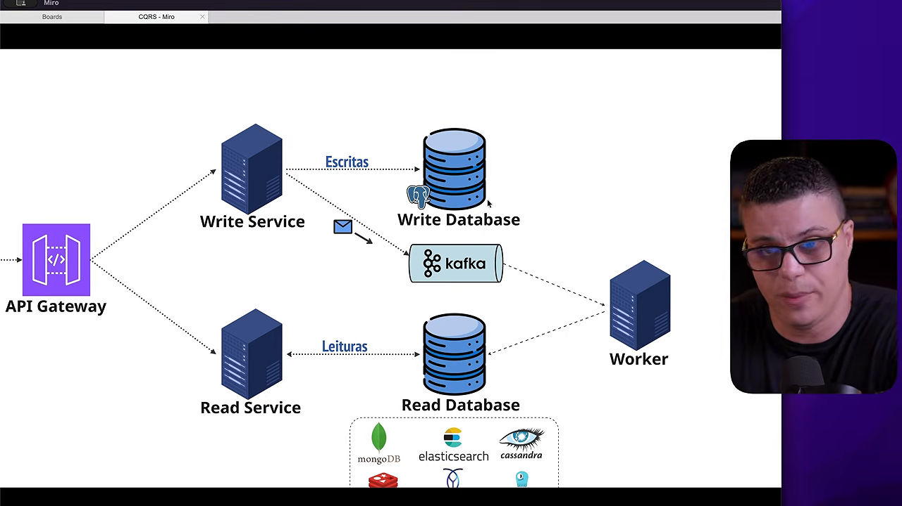
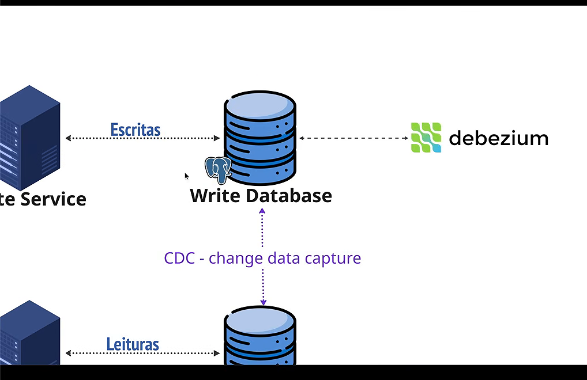
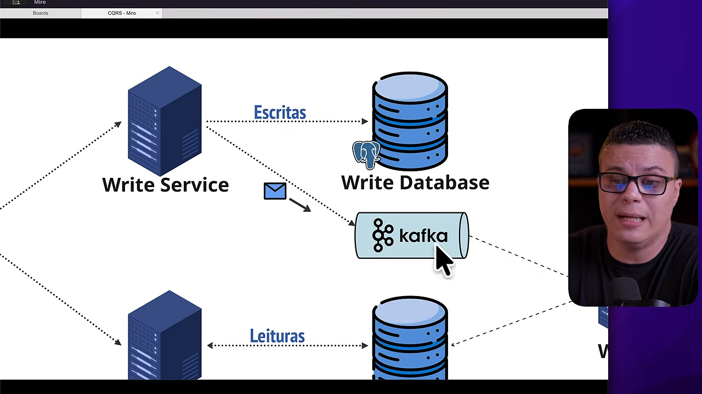

# CQRS para quem já manja — visão técnica

> Base: vídeo do Renato Augusto + discussão de trade-offs. Figuras em `frames/`.

## O que o padrão resolve de verdade

CQRS não é "dois bancos". É reconhecer que **os modelos de escrita e leitura
têm cargas, invariantes e formatos ótimos diferentes**:

- O **write model** existe para proteger invariantes de negócio (saldo não pode
  ficar negativo, estoque não pode duplicar). Normalização e transações são
  features aqui.
- O **read model** existe para servir a tela. Não precisa de invariante nenhuma
  — precisa ser *rápido e pronto*: documento denormalizado, agregação prévia,
  índice de busca. JOIN em leitura é sinal de que o modelo está errado.

O vídeo mostra bem a escada de maturidade:

| Estágio | O que é | Limite |
|---|---|---|
| 1 DB só | CRUD tradicional | leitura pesada compete com escrita |
| + read replicas | descarrega carga de leitura | **mesmo schema** — a query complexa continua complexa |
| CQRS | modelos diferentes por natureza | complexidade operacional + consistência eventual |

## O que separa "read replica" de CQRS

Pergunta clássica de entrevista/design review. Réplica de leitura **copia bits**
— o modelo de dados é idêntico. CQRS **transforma semântica**: o worker projeta
eventos de domínio numa estrutura pensada para a consulta (ex.: item único com
produto+estoque+preço+reputação do vendedor já resolvidos).

## Mecânica de sincronização — 3 sabores

1. **Publicação dupla (a nossa demo)**: o serviço grava no write DB e publica o
   evento no broker. Simples, mas tem o problema clássico do *dual write*: se o
   processo morre entre o commit e o publish, o evento se perde.
2. **Transactional outbox**: grava o evento numa tabela `outbox` na **mesma
   transação** do write model; um relay publica depois. Elimina o dual write.
3. **CDC (Debezium)**: lê o WAL/binlog do write DB e transforma mudanças em
   eventos — zero acoplamento no código de aplicação, mas os eventos são
   físicos ("linha mudou") e não de domínio ("PreçoAlterado").

## Event Sourcing ≠ CQRS

O vídeo menciona Event Sourcing junto — vale separar:

- **CQRS** separa modelos de leitura/escrita. O write side ainda pode guardar
  estado atual.
- **Event Sourcing** guarda o *log de eventos* como fonte da verdade; o estado
  atual é derivado dele. ES quase implica CQRS (você projeta para ler); CQRS
  não implica ES.

## Consistência eventual — o trade-off central

A janela entre "comando aceito" e "read model projetado" é real. Consequências
práticas:

- **Read-your-writes**: se a UX exige ver a própria escrita imediatamente
  (ex.: editou perfil e recarrega a tela), ou você espera a projeção, ou lê do
  write model (furo na segregação, mas pragmático), ou usa version/sticky read.
- **Ordenação**: eventos fora de ordem corrompem a projeção — garanta ordem por
  agregado (partição por `product_id`) e/ou guarde version/timestamp e descarte
  eventos velhos.
- **Idempotência**: a fila pode entregar duplicado; a projeção precisa ser
  idempotente (upsert por chave resolve na maioria dos casos).
- **Reprojeção**: se o read model bugar ou mudar de formato, o ideal é poder
  reprocessar os eventos (fácil com ES/outbox; com CDC puro, pense em como
  resemear).

## Quando NÃO usar (parte que o vídeo bate forte)

- CRUD corporativo, leitura ~ escrita, relatórios leves → tradicional.
- Times sem maturidade operacional para rodar broker + workers + monitorar lag.
- Domínios onde a consulta precisa ser fortemente consistente sempre.

CQRS por contexto delimitado, não por sistema: parte do sistema com CQRS,
parte sem — normal e desejável.

## Como a demo mapeia nos conceitos

| Conceito | Implementação local (Floci) | Produção típica |
|---|---|---|
| Command API | `write_service.py` (CLI) | HTTP/gRPC service |
| Write model | DynamoDB `products-write` | Postgres/MySQL |
| Broker | SNS → SQS | Kafka (+ Debezium se CDC) |
| Projeção | `projection_worker.py` polling SQS | Kafka consumer / Flink |
| Read model | DynamoDB `products-read` | Elasticsearch/Mongo/Redis |
| Query API | `read_service.py` | Read service / BFF |

Pontos de discussão para o estudo com código na mão:

1. Onde o dual-write pode falhar aqui? (crash entre `put_item` e `sns.publish`)
2. Como tornar a projeção idempotente e ordenada? (já é upsert por chave; falta version)
3. O que muda se o read model precisar de busca textual? (trocar DynamoDB por ES)
4. Como resemear o read model do zero? (scan do write + re-publicar eventos)

Ver roteiro prático em `03-roteiro-demo.md`.
